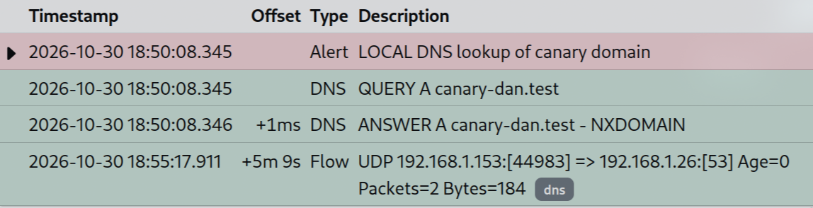

# Homelab Detections

Custom Suricata rules I wrote, tested and tuned in my home lab. I triggered every rule on purpose, confirmed it in EveBox, and triaged it like a SOC alert (comment, then archive).

## Lab setup

- **Sensor:** Debian 13 server running Suricata 7.0 in IDS mode on the LAN interface, with the ET Open ruleset plus these custom rules
- **Alert dashboard:** EveBox (Docker), reachable only over Tailscale
- **DNS:** Pi-hole on a Raspberry Pi 5
- **Test machine:** Arch Linux laptop on the same LAN

## Rules

| SID | Detects | Tested with |
|---|---|---|
| 1000101 | TCP SYN port scan | `nmap -sS -p 1-1000` |
| 1000102 | DNS lookup of a canary domain | `dig canary-dan.test` |
| 1000103 | nmap host discovery (ICMP timestamp) | `nmap -sn --send-ip` |
| 1000104 | SSH brute force | 8 rapid failed SSH logins from the Raspberry Pi |

Full rules: [`rules/local.rules`](rules/local.rules)

### 1000101: SYN port scan

Alerts when one source sends 20+ SYN packets to the home network within 10 seconds. `threshold:type both` makes it fire **once per window**, so a 1,000-port scan gives one alert instead of 1,000.

**Test:** a SYN scan of 1,000 ports from the laptop gave one alert with the laptop as the source. nmap reported 1 port open and 999 filtered by the host firewall (ufw), but Suricata still saw the scan, because it captures packets before the firewall drops them.

### 1000102: Canary DNS lookup

Alerts on any DNS query for `canary-dan.test`. It's the same pattern you'd use to watch for a known-bad domain from threat intel.

**Test:** `dig canary-dan.test` from the server. In EveBox's flow view, the alert was linked to the DNS query and the NXDOMAIN answer 27 ms later.

### 1000103: nmap host discovery (ICMP timestamp)

**I found a detection gap:** `nmap -sn` (ping sweep) produced no alerts at all.

- On the same subnet, nmap running as root only sends an **ARP request**. That's layer 2, and Suricata doesn't alert on it.
- Even when nmap is made to send IP probes (`--send-ip`), it sends just 4 packets (ICMP echo, SYN to 443, ACK to 80, ICMP timestamp), which is far below rule 1000101's threshold.

**Fix:** alert on **ICMP type 13 (timestamp request)**. Normal software almost never sends it, but nmap includes it in host discovery by default, so it's a high-signal, low-noise indicator.

**Known limit:** ARP-only discovery on the local subnet still isn't detected. That would need an ARP monitor such as arpwatch.

### 1000104: SSH brute force

Alerts when one source opens 5+ new SSH connections to the home network within 60 seconds. My own SSH sessions go over Tailscale, which Suricata sees only as encrypted tunnel traffic, so they don't cause false positives.

**Test:** from the Raspberry Pi, 8 rapid login attempts as a user that doesn't exist (`ssh -o BatchMode=yes fakeuser@<server>`). Result: one alert, priority 1.

**Matching the alert to host logs:** Suricata only sees connections, so I checked the alert against the server's SSH log (`journalctl -u ssh`):
- The alert's source port (51504) matched the **5th** connection in the SSH log, exactly where the rule's threshold trips.
- Every attempt logged `Invalid user fakeuser` and closed `[preauth]`, so **no login succeeded**.
- OpenSSH's built-in `srclimit_penalise` also started throttling the source.

**Tuning:** the first version used `flow:stateless`, and Suricata warned that the rule had no direction. I changed it to `flow:to_server` and bumped it to `rev:2`.

## Finding along the way: DNS skipping the Pi-hole

The canary alert showed the server's DNS going to the **router (192.168.1.1)** instead of the Pi-hole, even though I had configured it to use the Pi-hole.

**Root cause:** I had added `nohook resolv.conf` to `/etc/dhcpcd.conf`, but dhcpcd had been running since before that edit and never reloaded its config. One minute after the edit, it renewed its lease and overwrote `/etc/resolv.conf` with the router's DNS (IPv4 and IPv6).

**Fix:** reloaded dhcpcd (`dhcpcd -n eno1`), rewrote `resolv.conf` with the Pi-hole as primary and Quad9 as fallback, then forced another lease renewal to confirm the file stayed put. Running the canary again showed the **Pi-hole (192.168.1.26)** as the destination, so the IDS confirmed the fix too.

## Lessons

- A detection isn't done until you've triggered it and seen the alert.
- Know what a tool actually puts on the wire. `nmap -sn` on a local subnet is ARP, not IP.
- Most services only read their config at startup. After changing it, reload and verify.
- Match network alerts against host logs. The IDS shows the connection; the host log shows whether the attacker got in.

## Next

- Harden SSH on the Raspberry Pi
- Cloud honeypot feeding logs back to the home SOC
- Move the lab onto Proxmox with snapshot-able service VMs
